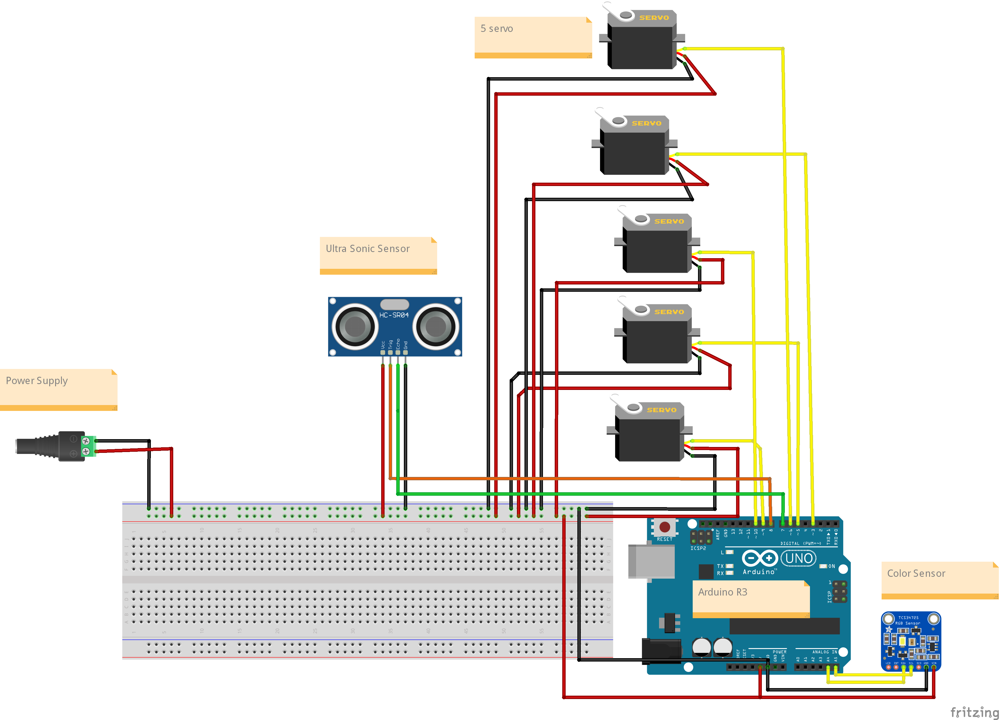

# Pick and Place Color-Sorting Object Robot Arm

An automated **4-DOF Pick-and-Place Color-Sorting Robotic Arm** controlled by an **Arduino UNO R3**. The system detects when an object enters the pickup zone using an **HC-SR04 ultrasonic sensor**, identifies its color (**Blue**, **Green**, or **Red**) using a **TCS34725 I2C RGB color sensor**, and smoothly drives a **5-servo robotic arm and gripper** using geometric **Inverse Kinematics (IK)** to place the object into its matching sorting bin.

## 3D Model Preview

*360° animated preview of [`3d Model.stl`](3d%20Model.stl) (parametric OpenSCAD source: [`3d Model.scad`](3d%20Model.scad)).*

## Circuit Schematic

### Power & Grounding Architecture
As shown in the Fritzing wiring diagram ([`Schematics.png`](Schematics.png)):
- **External Power Supply**: A dedicated external power supply connected via a DC barrel jack adapter powers the breadboard `+`/`-` rails, supplying high current directly to the **5 servo motors** without overloading the Arduino's onboard voltage regulator.
- **Common Ground**: The Arduino UNO R3 `GND` pin is connected to the breadboard negative rail so the Arduino, external servo power supply, and sensors share a common ground reference.
- **Sensor Power**: The **HC-SR04** (`VCC`) and **TCS34725** (`VIN`) are powered from the Arduino UNO `5V` pin and share the common ground.

---

## Hardware Components & Pinout

| Component | Module / Function | Arduino UNO Pin | Notes |
| :--- | :--- | :--- | :--- |
| **Microcontroller** | Arduino UNO R3 | — | Single-file controller at `9600` baud Serial |
| **Ultrasonic Sensor** | HC-SR04 `Echo` | `D7` | Object presence threshold: `<= 10.0 cm` (`30 ms` timeout) |
| **Ultrasonic Sensor** | HC-SR04 `Trig` | `D8` | `10 µs` trigger pulse |
| **RGB Color Sensor** | TCS34725 `SDA` (I2C) | `A4` | Hardware I2C address `0x29` |
| **RGB Color Sensor** | TCS34725 `SCL` (I2C) | `A5` | `50 ms` integration time, `4x` analog gain (`LED`/`INT` unconnected) |
| **Servo 1** | Joint 1 — Base rotation | `D9` | Calibrated PWM: `550–2014 µs` |
| **Servo 2** | Joint 2 — Shoulder pitch | `D5` | PWM bounds: `500–2500 µs` |
| **Servo 3** | Joint 3 — Elbow pitch | `D10` | PWM bounds: `500–2500 µs` |
| **Servo 4** | Joint 4 — Wrist pitch | `D6` | Calibrated PWM: `550–2141 µs` (`-45°` mechanical offset) |
| **Servo 5** | Gripper mechanism | `D3` | Open: `90°`, Close: `120°`, Standby: `150°` |

---

## 3D Model & Physical Layout

The complete mechanical layout and printable parts are provided in [`3d Model.stl`](3d%20Model.stl) and its parametric OpenSCAD source [`3d Model.scad`](3d%20Model.scad).

### Robotic Arm Link Dimensions
- **Base height (`L1`)**: `64.50 mm` (surface to Joint 2 pivot)
- **Upper arm (`L2`)**: `105.00 mm` (Joint 2 to Joint 3)
- **Forearm (`L3`)**: `98.50 mm` (Joint 3 to Joint 4)
- **Wrist + Gripper (`L4`)**: `115.00 mm` (Joint 4 to end-effector tip)
- **Wrist Mounting Offset**: `45.00°`

### Board & Target Coordinates (OpenSCAD Reference)
- **Base Board**: `360 x 280 x 3.175 mm` (`X ∈ [-180, 180]`, `Y ∈ [-140, 140]`)
- **Arm Base Origin**: `(-15, 20, 3.175)` mm
- **Arduino UNO R3 Mount**: `(-132, -6.6, 3.175)` mm (behind the arm base)
- **Angled Sensor Mount**: `X = 108 mm`, angled at `-42°` overlooking the pickup window (`TCS34725` at `[108, -1, 40.675]`, `HC-SR04` at `[108, 31, 40.675]`)
- **Pickup Basket**: `(75, 15, 3.175)` mm with sensor window (`74 x 74 x 36 mm`) + inverted stand at `(148, 15, 3.175)` mm → **IK Target**: `(180.00, 40.00, 10.00)` mm
- **Travel Clearance**: `TRAVEL_Y = 150.00 mm`, `TRANSIT_Z = 120.00 mm`, `CONTAINER_DROP_Y = 50.00 mm`
- **Front-Row Sorting Baskets** (OpenSCAD `Y = -85 mm`, `36 mm` height):
  - **Green Bin** (Left, Black): Board `(-115, -85, 3.175)` mm → **IK Target**: `(-162.07, 50.00, 170.17)` mm
  - **Blue Bin** (Middle, RoyalBlue): Board `(-35, -85, 3.175)` mm → **IK Target**: `(-36.84, 50.00, 193.41)` mm
  - **Red Bin** (Right, WhiteSmoke): Board `(45, -85, 3.175)` mm → **IK Target**: `(104.65, 50.00, 183.15)` mm

### Reference Tested Object Specifications
- **Blue object**: `32 g`, `3.1 cm x 3.4 cm x 5.1 cm`
- **Green object**: `29 g`, `3.1 cm x 3.4 cm x 4.6 cm`
- **Red object**: `31 g`, `3.1 cm x 3.4 cm x 4.9 cm`

---

## How It Works & Code Structure

The firmware in [`Pick_and_Place_Color_Sorting_Object_RobotArm.ino`](Pick_and_Place_Color_Sorting_Object_RobotArm.ino) is self-contained and organized into five sections:

1. **Hardware Pins, Constants, & Data Structures** — Pin mappings, TCS34725 register constants, calibrated servo PWM bounds, link lengths, and IK target coordinates.
2. **Ultrasonic Sensor (`HC-SR04`)** — `readDistanceCm()` sends a `10 µs` trigger pulse and converts echo duration into centimeters (`999.0 cm` on timeout).
3. **Color Sensor (`TCS34725` I2C)** — Communicates directly via `Wire.h` (`0x29`), normalizes 16-bit RGB channels against the Clear channel (`0–255`), and classifies `COLOR_BLUE`, `COLOR_GREEN`, or `COLOR_RED` when `rawClear >= 50` and the dominant channel exceeds the others by `15`.
4. **Servo, Gripper, & Inverse Kinematics** — `calculateInverseKinematics()` solves 4-DOF joint angles (`theta1..theta4`) using the Law of Cosines while keeping link `L4` horizontal, and `moveAxisSmooth()` interpolates along each axis in `0.10 mm` increments (`100 µs` step delay) to execute the pick-and-place cycle.
5. **Main Program (`setup` & `loop`)** — Continuously polls distance and color; holds the arm in standby (`GRIPPER_STANDBY_ANGLE = 150°`) when no object is present, or executes `pickAndPlace()` to the matching color bin.

---

## Getting Started

1. Wire the Arduino UNO R3, 5 servos, external servo power supply, HC-SR04, and TCS34725 according to [`Schematics.png`](Schematics.png).
2. Open [`Pick_and_Place_Color_Sorting_Object_RobotArm.ino`](Pick_and_Place_Color_Sorting_Object_RobotArm.ino) in the **Arduino IDE**.
3. No external third-party color sensor library is needed—only standard built-in Arduino libraries (`Wire.h`, `Servo.h`, and `math.h`) are used.
4. Select **Arduino Uno** and the appropriate serial port, then click **Upload**.
5. Open the **Serial Monitor** at `9600` baud to inspect real-time normalized `R`, `G`, `B`, and `C` sensor readings for calibration.

---

## Repository Files

- [`Pick_and_Place_Color_Sorting_Object_RobotArm.ino`](Pick_and_Place_Color_Sorting_Object_RobotArm.ino) — Complete Arduino UNO R3 controller sketch
- [`Schematics.png`](Schematics.png) — Fritzing circuit wiring diagram
- [`3d Model.stl`](3d%20Model.stl) — 3D assembly model (base board, arm mounts, sensor mount, pickup & sorting baskets)
- [`3d Model.scad`](3d%20Model.scad) — OpenSCAD parametric 3D source file
- [`3d_Model_Preview.gif`](3d_Model_Preview.gif) — 360° rotating 3D model preview animation
- [`3d Model.png`](3d%20Model.png) — Static 3D model preview render
- [`README.md`](README.md) — Project documentation, pinout, and kinematics reference
