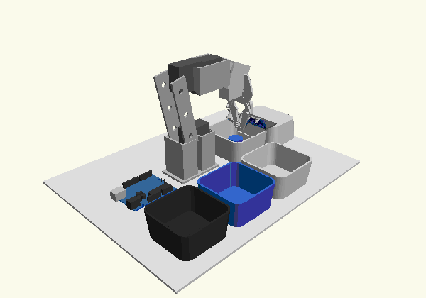

# Pick and Place Color-Sorting Object Robot Arm

An automated **6-Servo Pick-and-Place Color-Sorting Robotic Arm** controlled by an **Arduino UNO R3**. The system detects objects entering the pickup zone using an **HC-SR04 ultrasonic sensor** and an **Adafruit_TCS34725 I2C RGB color sensor** (`50 ms` integration time, `4x` gain, fast single-sample `50 ms` read, IR offset subtraction, gentle warm-LED RGB compensation, calibrated `0–255` luminance scaling, `PROGMEM` White/Black shade & RGB range category matching, and HSV Hue/Saturation classification), classifies **White**, **Black**, and **All Colors** (**Red**, **Green**, **Blue**, and other chromatic colors like Yellow, Orange, Purple, Pink, Cyan, etc.) without hesitation (or ignores `WALANG OBJECT` / `COLOR_NONE`), and smoothly drives a **6-servo robotic arm** (base rotation, shoulder, elbow, wrist pitch, wrist roll, and gripper claw with `600–2400 µs` MG996R PWM limits) using **calibrated joint poses & smooth 1°/step interpolation** to sort objects into the **Mid** (White Only), **Left** (Black), and **Right** (All Colors) baskets.

## 3D Model Preview

*360° animated preview of [`3d Model.stl`](3d%20Model.stl) (parametric OpenSCAD source: [`3d Model.scad`](3d%20Model.scad)).*

## Circuit Schematic

### Power & Grounding Architecture
As shown in the Fritzing wiring diagram ([`Schematics.png`](Schematics.png)):
- **External Power Supply**: A dedicated external power supply connected via a DC barrel jack adapter powers the breadboard `+`/`-` rails, supplying high current directly to the **6 servo motors** without overloading the Arduino's onboard voltage regulator.
- **Common Ground**: The Arduino UNO R3 `GND` pin is connected to the breadboard negative rail so the Arduino, external servo power supply, and sensors share a common ground reference.
- **Sensor Power**: The **HC-SR04** (`VCC`) and **TCS34725** (`VIN`) are powered from the Arduino UNO `5V` pin and share the common ground.

---

## Hardware Components & Pinout

| Component | Module / Function | Arduino UNO Pin | Notes |
| :--- | :--- | :--- | :--- |
| **Microcontroller** | Arduino UNO R3 | — | Single-file controller at `9600` baud Serial |
| **Ultrasonic Sensor** | HC-SR04 `Echo` | `D7` | Detection range: `1.5 cm – 6.2 cm` (`< 7.1 cm` opposite wall), 2 consecutive hits (`REQUIRED_HITS = 2`, `15 ms` timeout, `isObjectInRangeWithRetry()` retry) |
| **Ultrasonic Sensor** | HC-SR04 `Trig` | `D8` | `10 µs` trigger pulse |
| **RGB Color Sensor** | TCS34725 `SDA` (I2C) | `A4` | `Adafruit_TCS34725` library (`50 ms` integration, `4x` gain, onboard LED enabled via `setInterrupt(false)`) |
| **RGB Color Sensor** | TCS34725 `SCL` (I2C) | `A5` | Fast single-sample `50 ms` read, IR offset removal, calibrated post-IR RGB gains (`rGain = 0.89`, `gGain = 0.84`, `bGain = 1.45`), two-point `whiteChRef = 520.0f` / `blackChRef` (`0–255` luminance scaling), `PROGMEM` lookup (`WHITE_SHADES`, `BLACK_SHADES`, `RGB_RANGE_CATEGORIES`), HSV Hue (`0°–360°`, `0–359 deg`) & Saturation (`0%–100%`), `topGapPct`, classifies `WHITE`, `BLACK`, `RED`, `GREEN`, `BLUE`, `COLOR` (`COLOR_OTHER`), `WALANG OBJECT` (enum also defines `COLOR_NONE`) |
| **Servo 1** | Base Rotation (`servos[0]`) | `D9` | Swings arm between pickup (`140°`–`160°`) and sorting buckets (`15°`–`100°`) |
| **Servo 2** | Shoulder (`servos[1]`) | `D5` | Vertical arm elevation and reach (`120°` pickup, `135°`–`175°` standby/buckets) |
| **Servo 3** | Elbow (`servos[2]`) | `D10` | Forearm extension (`25°` transit/standby, `40°` pickup dip, `5°`–`30°` buckets) |
| **Servo 4** | Wrist Pitch (`servos[3]`) | `D6` | End-effector pitch angle (`45°` pickup, `35°`–`65°` standby/buckets) |
| **Servo 5** | Wrist Roll (`servos[4]`) | `D11` | End-effector roll orientation (`55°` at `BASE_POSE`, `40°` at `PICKUP_POSE`, `35°` at bucket poses) |
| **Servo 6** | Gripper Claw (`servos[5]`) | `D3` | `20°` Open (`GRIP_FULL_OPEN` / `GRIP_OPEN_ANGLE`) / `180°` Closed (`GRIP_FULL_CLOSE` / `GRIP_CLOSE_ANGLE`) |

- **MG996R Servo PWM Pulse Limits**: All 6 servos (`servoNames[0..5]`) are attached with `MG996R_MIN_US = 600` (`600 µs`) and `MG996R_MAX_US = 2400` (`2400 µs`) via `servos[i].attach(servoPins[i], MG996R_MIN_US, MG996R_MAX_US)` for full `0°–180°` travel.

---

## Calibrated 6-Servo Poses

All poses follow the joint order `{ Base (D9), Shoulder (D5), Elbow (D10), Wrist Pitch (D6), Wrist Roll (D11), Gripper (D3) }` in degrees:

| Pose Name | Target / Role | Base (`D9`) | Shoulder (`D5`) | Elbow (`D10`) | Wrist Pitch (`D6`) | Wrist Roll (`D11`) | Gripper (`D3`) | Array Literal |
| :--- | :--- | :---: | :---: | :---: | :---: | :---: | :---: | :--- |
| `BASE_POSE` | Base Hover / Standby | `160` | `175` | `25` | `65` | `55` | `180` | `{ 160, 175, 25, 65, 55, 180 }` |
| `PICKUP_POSE` | Pickup Location Grab Pose | `140` | `120` | `40` | `45` | `40` | `20` | `{ 140, 120, 40, 45, 40, 20 }` |
| `MID_BUCKET_POSE` | Mid Bucket → **White Only** | `60` | `150` | `25` | `60` | `35` | `180` | `{ 60, 150, 25, 60, 35, 180 }` |
| `LEFT_BUCKET_POSE` | Left Bucket → **Black** | `100` | `150` | `30` | `35` | `35` | `180` | `{ 100, 150, 30, 35, 35, 180 }` |
| `RIGHT_BUCKET_POSE` | Right Bucket → **All Colors (Red, Green, Blue, etc.)** | `15` | `135` | `5` | `60` | `35` | `180` | `{ 15, 135, 5, 60, 35, 180 }` |

- **High-Clearance Upper-Arm Transit Posture**: `{ Shoulder, Elbow, Wrist Pitch, Wrist Roll } = { 175, 25, 65, 55 }` — lifted prior to any `Base (D9)` rotation so the gripper clears the pickup housing and sorting bins.

---

## 3D Model & Physical Layout

The complete mechanical layout and printable parts are provided in [`3d Model.stl`](3d%20Model.stl) and its parametric OpenSCAD source [`3d Model.scad`](3d%20Model.scad) (static render: [`3d Model.png`](3d%20Model.png)).

### Robotic Arm Link Dimensions
- **Base height (`L1`)**: `64.50 mm` (surface to Joint 2 pivot)
- **Upper arm (`L2`)**: `105.00 mm` (Joint 2 to Joint 3)
- **Forearm (`L3`)**: `98.50 mm` (Joint 3 to Joint 4)
- **Wrist + Gripper (`L4`)**: `115.00 mm` (Joint 4 to end-effector tip)
- **Wrist Mounting Offset**: `45.00°`

### Board & Station Coordinates (OpenSCAD Reference)
- **Base Board**: `360 x 280 x 3.175 mm` (`X ∈ [-180, 180]`, `Y ∈ [-140, 140]`)
- **Arm Base Origin**: `(-15, 20, 3.175)` mm
- **Arduino UNO R3 Mount**: `(-132, -6.6, 3.175)` mm (behind the arm base)
- **Angled Sensor Mount**: `X = 108 mm`, angled at `-42°` overlooking the pickup window (`TCS34725` at `[108, -1, 40.675]`, `HC-SR04` at `[108, 31, 40.675]`)
- **Pickup Basket**: `(75, 15, 3.175)` mm with sensor window (`74 x 74 x 36 mm`) + inverted stand at `(148, 15, 3.175)` mm → **`PICKUP_POSE`** (`Base = 140°`)
- **Front-Row Sorting Baskets** (OpenSCAD `Y = -85 mm`, `36 mm` height):
  - **Left Basket (Black)** (`Black` container): Board `(-115, -85, 3.175)` mm → **`LEFT_BUCKET_POSE`** (`Base = 100°`)
  - **Mid Basket (White Only)** (`WhiteSmoke` container): Board `(-35, -85, 3.175)` mm → **`MID_BUCKET_POSE`** (`Base = 60°`)
  - **Right Basket (All Colors — Red, Green, Blue, etc.)** (`RoyalBlue` container): Board `(45, -85, 3.175)` mm → **`RIGHT_BUCKET_POSE`** (`Base = 15°`)

### Reference Tested Object Specifications
- **Blue object**: `32 g`, `3.1 cm x 3.4 cm x 5.1 cm`
- **Green object**: `29 g`, `3.1 cm x 3.4 cm x 4.6 cm`
- **Red object**: `31 g`, `3.1 cm x 3.4 cm x 4.9 cm`

---

## How It Works & Trajectory Sequence

The firmware in [`Pick_and_Place_Color_Sorting_Object_RobotArm.ino`](Pick_and_Place_Color_Sorting_Object_RobotArm.ino) is self-contained and operates in the following sequence:

### 1. Staggered Startup (`setup()`)
- Starts `Serial` at `9600` baud, prints the startup banner, configures HC-SR04 trigger/echo pins (`D8`/`D7`), and initializes the `Adafruit_TCS34725` sensor (`50 ms` integration time, `4x` gain, onboard LED enabled via `tcs.setInterrupt(false)`).
- Attaches all 6 servos one-by-one with a **`600 ms` delay** between each servo using MG996R pulse limits (`MG996R_MIN_US = 600` to `MG996R_MAX_US = 2400` via `servos[i].attach(servoPins[i], MG996R_MIN_US, MG996R_MAX_US)`), pre-positioning every joint directly to **`BASE_POSE`** (`{ 160, 175, 25, 65, 55, 180 }`) to prevent power-rail brownouts.
- Prints the organized command reference (`printHelpMenu()`) and initial joint angles (`printAllAngles()`) before entering `loop()`.

### 2. Object Detection & Color Sensing (`loop()`)
- **Ultrasonic Range Gating & 2-Hit Stability Filter (`HC-SR04`)**: Every `30 ms` (while `isRunning` is active; paused automatically if `gripperLoopRunning` is enabled), `readDistanceCM()` measures distance using a `15000 µs` / `15 ms` timeout (`ECHO_TIMEOUT_US`), returning `-1` on timeout or `(duration * 0.0343) / 2.0` in centimeters. Only objects within `MIN_RANGE = 1.5 cm` to `MAX_RANGE = 6.2 cm` (safely below the `7.1 cm` opposite wall of the pickup basket) increment `hitCount`, resetting `hitCount = 0` whenever the reading is out of range.
- **Color Reading, HSV Hue Classification & Bucket-Consensus Confirmation (`Adafruit_TCS34725`)**: Once `hitCount >= REQUIRED_HITS` (`2` consecutive readings in range), the controller prints `OBJECT DETECTED! Distance: <distance> cm`, waits **`40 ms`** (`PRE_READ_SETTLE_MS`) and re-verifies ultrasonic presence via `isObjectInRangeWithRetry()` (single ping with a `15 ms` retry if the first ping misses) so a newly dropped object rests flat before sampling, then reads the object color via `readAndDetectColor(true)` (if `objectDetected` is `false`, such as during manual `'c'` or `'v'` tests, `readAndDetectColor(bool objectDetected = false)` first checks ultrasonic presence via `readDistanceCM()`).
  - **Signal Conditioning & HSV Metrics**: `sampleColorAverages()` performs 1 hardware-integrated `50 ms` `tcs.getRawData()` reading (~`50 ms`) and stores `LastClear = (int)c`. `computeIrOffset()` subtracts estimated IR leakage, then calibrated post-IR gains (`rGain = 0.89`, `gGain = 0.84`, `bGain = 1.45`, adjustable live via `'w'`) produce balanced `r_bal`, `g_bal`, and `b_bal` channels. From `maxCh`, `minCh`, `midCh`, and `delta = maxCh - minCh`, it computes HSV Saturation (`satPct` / `LastSat`, `0%–100%`), top-channel dominance gap (`topGapPct`, `0%–100%`), and HSV Hue (`hueDeg` / `LastHue`, `0°–360°` wrapped to `0–359 deg`, suppressed to `0` on achromatic readings with `satPct <= 2%`).
  - **Calibrated Luminance-Scaled RGB & `PROGMEM` Matching**: Maps `(r_bal, g_bal, b_bal)` into `0–255` calibrated RGB channels (`calR`, `calG`, `calB`) using two-point calibration: `darkFloor = (blackChRef > 5.0f && blackChRef < whiteChRef * 0.65f) ? (blackChRef * 0.65f) : 0.0f` and `scale255 = 255.0f / max(1.0f, whiteChRef - darkFloor)` (`whiteChRef = 520.0f` default for White `C ~ 1766`, auto-updated to `avg_ir` during `'w'`; `blackChRef = 0.0f` default, auto-updated during `'z'`) and computes `calMax`, `calMin`, and `calDelta = calMax - calMin`. `matchRgbCategoryIndex(calR, calG, calB)` scans `RGB_RANGE_CATEGORIES` (`15` `PROGMEM` entries via `memcpy_P`) in index order `0..14` and returns the first matching category index (or `-1` if none match, displayed as `Custom`). `findNearestShadeIndex(Red, Green, Blue, table, count)` matches `(calR, calG, calB)` against `WHITE_SHADES` (`30` entries) or `BLACK_SHADES` (`24` entries) in `PROGMEM` by minimizing 32-bit `long` squared Euclidean distance (`dr*dr + dg*dg + db*db`, preventing 16-bit AVR `int` overflow).
  - **Thresholds, Achromatic Categories & Chromatic RGB Scaling**: Uses `NO_OBJECT_MAX_C = 42`, `whiteRefC = 1766`, `blackRefC = -1` (optional measured Black reference via `'z'`), `whiteChRef = 520.0f`, `blackChRef = 0.0f`, `blackSolidMaxC = 40` (auto-scaled `25–60` with `'z'` or `25–55` with `'w'`), `blackMaxC = 850` (auto-scaled from `whiteRefC` / `blackRefC` via `'w'` and `'z'`), `whiteMinC = 1020`, `whiteBrightMinC = 1320`, `WHITE_MAX_SAT_PCT = 26%`, `WHITE_BRIGHT_MAX_SAT_PCT = 30%`, `WHITE_MAX_TOPGAP_PCT = 17%`, `DARK_COLOR_MIN_SAT_PCT = 32%`, and `COLOR_MIN_SAT_PCT = 22%`.
    - **Chromatic Guard & Black/White (`7b`, `7c`, `7e`)**: `isClearlyChromatic = ((calDelta >= 26) && ((satPct >= 34) || (satPct >= 25 && topGapPct >= 18))) || ((c >= 45.0f) && (calDelta >= 18) && (satPct >= 46) && (topGapPct >= 24))` protects both bright and dark saturated colors from leaking into Black or White while preventing any of the 24 Black shades (`calDelta <= 25`) from triggering chromatic bounce. `7a` only returns `WALANG OBJECT` when `!objectDetected` so ultrasonic-confirmed pitch-black objects are never dropped; `7b` uses `inBlackCategory = (catIdx >= 12 && catIdx <= 14)` (`Dark Gray`, `Charcoal`, `Black`), `isPitchBlack = (c < blackSolidMaxC) || (calMax <= 18)`, and `isBlackShade = isPitchBlack || (!isClearlyChromatic && ((calMax <= 55) || (inBlackCategory && satPct <= 35)))`; `7c` requires `!isClearlyChromatic && c >= whiteMinC` with `inWhiteCategory = (catIdx >= 0 && catIdx <= 10)` (`Pure White`..`Light Gray`); both set `Red = calR`, `Green = calG`, `Blue = calB`, and `LastHue = 0`; and `7e` splits the neutral transition band cleanly at `achromaticMidC = (blackMaxC + whiteMinC) / 2` (`c >= achromaticMidC` → `WHITE [MID BUCKET]`, `c < achromaticMidC` → `BLACK [LEFT BUCKET]`).
    - **Chromatic (`7d`)**: Scales `Red`, `Green`, `Blue` (`0–255`) using `floorCh = minCh * 0.65` and `span = max(1.0, maxCh - floorCh)` for hue-accurate `#RRGGBB` output.
  - **Serial Telemetry (`printColorTelemetryPrefix()`, `printColorTelemetry()`, `printAchromaticTelemetry()`)**:
    - **White (`printAchromaticTelemetry()`)**: `rgb(R, G, B) (hex #RRGGBB) | Hue: 0 deg | Sat: <pct>% | C: <clear> -> WHITE [MID BUCKET] | Cat: <category> | Shade: <shade name>` (prints `rgb(255, 255, 255) (hex #FFFFFF)` when `calR, calG, calB` are `255, 255, 255`, `rgb(0, 0, 0) (#000000)` when `0, 0, 0`, and `Custom` when `catIdx == -1`)
    - **Black (`printAchromaticTelemetry()`)**: `rgb(R, G, B) (hex #RRGGBB) | Hue: 0 deg | Sat: <pct>% | C: <clear> -> BLACK [LEFT BUCKET] | Cat: <category> | Shade: <shade name>` (prints `rgb(0, 0, 0) (#000000)` when `calR, calG, calB` are `0, 0, 0`, and `Custom` when `catIdx == -1`)
    - **Empty (`printColorTelemetry()`)**: `rgb(0, 0, 0) (#000000) | Hue: 0 deg | Sat: 0% | C: <clear> -> WALANG OBJECT`
    - **Chromatic Colors (`printColorTelemetry()`)**: `rgb(R, G, B) (hex #RRGGBB) | Hue: <deg> deg | Sat: <pct>% | C: <clear> -> <LABEL>` (`RED [RIGHT BUCKET]`, `GREEN [RIGHT BUCKET]`, `BLUE [RIGHT BUCKET]`, or `COLOR [RIGHT BUCKET]`)
  - **Settle & Bucket-Level Majority Confirmation**: After **`25 ms`** (`SETTLE_DELAY_MS`), `loop()` re-checks ultrasonic presence via `isObjectInRangeWithRetry()` (resetting `hitCount = 0` and returning immediately if gone), takes a second reading `confirmed = readAndDetectColor(true)` (`secondC = LastClear`), and compares target buckets via `getTargetBucket()` (`1` = White, `2` = Black, `3` = All Colors, `0` = None) so e.g. `RED` and `COLOR` agree immediately on Right Bucket without extra delay. Only if `bucket1 != bucket2`, it waits **`20 ms`** for a 3rd tie-breaker `tieBreaker = readAndDetectColor(true)` (`thirdC = LastClear`, `bucket3`) and resolves by bucket majority (or prefers `bucket3 == 3` chromatic, `COLOR_WHITE` when `secondC`/`thirdC >= whiteMinC`, or `bucket3 != 0`; if `getTargetBucket(confirmed) == 0 && bucket1 != 0`, it retains `firstRead`). On a valid color, it resets `hitCount = 0` and executes `executePickAndPlace()`:
    - **Mid Bucket (`MID_BUCKET_POSE`, Base `60°`) — White Only**: `COLOR_WHITE` (`WHITE [MID BUCKET]`)
    - **Left Bucket (`LEFT_BUCKET_POSE`, Base `100°`) — Black**: `COLOR_BLACK` (`BLACK [LEFT BUCKET]`)
    - **Right Bucket (`RIGHT_BUCKET_POSE`, Base `15°`) — All Colors**: `COLOR_RED` (`RED`), `COLOR_GREEN` (`GREEN`), `COLOR_BLUE` (`BLUE`), and `COLOR_OTHER` (`COLOR` for Yellow, Orange, Purple, Pink, etc.)
    - **Ignored (`COLOR_NO_OBJECT`, `COLOR_NONE`)**: `WALANG OBJECT` (`(!objectDetected && c < NO_OBJECT_MAX_C)` with `NO_OBJECT_MAX_C = 42`, or `c < 8.0`) or `COLOR_NONE` — waits without picking up.

### TCS34725 Color Classification & Bucket Routing

| Enum Value | Serial Label | Classification Criteria (Evaluated in Strict Order) | Target Bucket Pose | Base Angle |
| :--- | :--- | :--- | :--- | :--- |
| `COLOR_NO_OBJECT` | `WALANG OBJECT` | `!objectDetected && (c < NO_OBJECT_MAX_C || c < 8.0)` (`42`, uses ultrasonic check when `objectDetected` is `false` — never drops ultrasonic-confirmed dark/pitch-black objects); prints `rgb(0, 0, 0) (#000000)` with `Hue: 0 deg` and `Sat: 0%` | *Ignored* | Remains at `BASE_POSE` |
| `COLOR_BLACK` | `BLACK [LEFT BUCKET]` | `isPitchBlack` (`c < blackSolidMaxC` (`40`) or `calMax <= 18`), or `(!isClearlyChromatic && c < blackMaxC && satPct < DARK_COLOR_MIN_SAT_PCT)` (`blackMaxC = 850` default, auto-scaled by `'w'` / `'z'`, `DARK_COLOR_MIN_SAT_PCT = 32%`), or `(c < whiteMinC && isBlackShade)` where `inBlackCategory = (catIdx >= 12 && catIdx <= 14)` (`Dark Gray`, `Charcoal`, `Black`) and `isBlackShade = isPitchBlack || (!isClearlyChromatic && ((calMax <= 55) || (inBlackCategory && satPct <= 35)))`; or achromatic fallback (`c < achromaticMidC`); sets `Red = calR`, `Green = calG`, `Blue = calB`, `LastHue = 0` and appends `\| Cat: <category> \| Shade: <shade name>` from `BLACK_SHADES` | `LEFT_BUCKET_POSE` | **Left Bucket — Black** (`100°`) |
| `COLOR_WHITE` | `WHITE [MID BUCKET]` | `!isClearlyChromatic && c >= whiteMinC` (`1020` default, auto-scaled by `'w'` / `'z'`) and (`(inWhiteCategory && satPct <= 28 && topGapPct <= 18)` where `inWhiteCategory = (catIdx >= 0 && catIdx <= 10)` (`Pure White`..`Light Gray`), or `(satPct <= WHITE_MAX_SAT_PCT && topGapPct <= WHITE_MAX_TOPGAP_PCT)` (`26%`, `17%`), or `(c >= whiteBrightMinC && satPct <= WHITE_BRIGHT_MAX_SAT_PCT && topGapPct <= 18)` (`1320`, `30%`), or `(satPct <= 22)`); or achromatic fallback (`c >= achromaticMidC`); sets `Red = calR`, `Green = calG`, `Blue = calB`, `LastHue = 0` and appends `\| Cat: <category> \| Shade: <shade name>` from `WHITE_SHADES` | `MID_BUCKET_POSE` | **Mid Bucket — White Only** (`60°`) |
| `COLOR_RED` | `RED [RIGHT BUCKET]` | Chromatic (`satPct >= COLOR_MIN_SAT_PCT` (`22%`) or `topGapPct >= 14%`) and Hue `330°–25°` (`hueDeg >= 330` or `hueDeg <= 25`), or Red-max (`r_bal == maxCh`) up to `32°` with `topGapPct >= 12%`; prints `rgb(R, G, B) (hex #RRGGBB)` | `RIGHT_BUCKET_POSE` | **Right Bucket — All Colors** (`15°`) |
| `COLOR_GREEN` | `GREEN [RIGHT BUCKET]` | Chromatic (`satPct >= 22%` or `topGapPct >= 14%`) and Hue `70°–168°`; prints `rgb(R, G, B) (hex #RRGGBB)` | `RIGHT_BUCKET_POSE` | **Right Bucket — All Colors** (`15°`) |
| `COLOR_BLUE` | `BLUE [RIGHT BUCKET]` | Chromatic (`satPct >= 22%` or `topGapPct >= 14%`) and Hue `170°–265°`; prints `rgb(R, G, B) (hex #RRGGBB)` | `RIGHT_BUCKET_POSE` | **Right Bucket — All Colors** (`15°`) |
| `COLOR_OTHER` | `COLOR [RIGHT BUCKET]` | Chromatic (`satPct >= 22%` or `topGapPct >= 14%`) outside R/G/B bands (`26°–69°` Yellow/Orange, `266°–329°` Purple/Magenta/Pink, plus `169°`); prints `rgb(R, G, B) (hex #RRGGBB)` | `RIGHT_BUCKET_POSE` | **Right Bucket — All Colors** (`15°`) |
| `COLOR_NONE` | `NONE` | Enum sentinel ignored in `loop()` (achromatic fallback routes neutral readings to `WHITE` when `c >= achromaticMidC` or `BLACK` when `c < achromaticMidC`) | *Ignored* | Remains at `BASE_POSE` |

### `PROGMEM` White/Black Shade & TCS34725 RGB Category Tables

All lookup tables are stored in AVR program flash (`<avr/pgmspace.h>`) using `ShadeRef` (`uint8_t r, g, b; char name[20];`) and `RgbRangeCategory` (`uint8_t rMin, rMax, gMin, gMax, bMin, bMax; char name[14];`), accessed on demand via `memcpy_P()` and `printProgmemStr()` (`pgm_read_byte()`):

#### 15 Recommended TCS34725 White, Gray & Black RGB Range Categories (`RGB_RANGE_CATEGORIES`, `NUM_RGB_CATEGORIES = 15`)
Matched in strict index order `0..14` by `matchRgbCategoryIndex(calR, calG, calB)` (returns `-1` / prints `Custom` if unmatched; indices `0..10` form `inWhiteCategory`, indices `12..14` form `inBlackCategory`):

| Index | Category Name | `R` Range | `G` Range | `B` Range | Classification Role |
| :---: | :--- | :---: | :---: | :---: | :--- |
| `0` | `Pure White` | `250–255` | `250–255` | `250–255` | `inWhiteCategory` |
| `1` | `Bright White` | `240–255` | `240–255` | `240–255` | `inWhiteCategory` |
| `2` | `Paper White` | `235–255` | `235–255` | `235–255` | `inWhiteCategory` |
| `3` | `Snow White` | `240–255` | `235–255` | `235–255` | `inWhiteCategory` |
| `4` | `Cool White` | `230–255` | `235–255` | `245–255` | `inWhiteCategory` |
| `5` | `Warm White` | `240–255` | `240–255` | `225–250` | `inWhiteCategory` |
| `6` | `Natural White` | `230–255` | `230–255` | `225–250` | `inWhiteCategory` |
| `7` | `Ivory` | `240–255` | `240–255` | `210–245` | `inWhiteCategory` |
| `8` | `Cream White` | `240–255` | `235–255` | `190–230` | `inWhiteCategory` |
| `9` | `Off-White` | `225–250` | `225–250` | `220–250` | `inWhiteCategory` |
| `10` | `Light Gray` | `180–220` | `180–220` | `180–220` | `inWhiteCategory` |
| `11` | `Gray` | `100–150` | `100–150` | `100–150` | Mid-gray telemetry label |
| `12` | `Dark Gray` | `50–90` | `50–90` | `50–90` | `inBlackCategory` |
| `13` | `Charcoal` | `30–70` | `30–80` | `30–90` | `inBlackCategory` |
| `14` | `Black` | `0–30` | `0–30` | `0–30` | `inBlackCategory` |

#### 30 White Shades (`WHITE_SHADES`, `NUM_WHITE_SHADES = 30`)
Matched by `findNearestShadeIndex(Red, Green, Blue, WHITE_SHADES, NUM_WHITE_SHADES)` using `long` squared Euclidean distance:

| # | Shade Name | `R, G, B` | # | Shade Name | `R, G, B` | # | Shade Name | `R, G, B` |
| :---: | :--- | :---: | :---: | :--- | :---: | :---: | :--- | :---: |
| `1` | `Pure White` | `255, 255, 255` | `11` | `Antique White` | `250, 235, 215` | `21` | `Alabaster` | `242, 240, 230` |
| `2` | `Bright White` | `254, 254, 254` | `12` | `Floral White` | `255, 250, 240` | `22` | `Chalk White` | `244, 244, 244` |
| `3` | `Paper White` | `252, 252, 252` | `13` | `Ghost White` | `248, 248, 255` | `23` | `Platinum White` | `229, 228, 226` |
| `4` | `Snow White` | `255, 250, 250` | `14` | `White Smoke` | `245, 245, 245` | `24` | `Light Gray White` | `240, 240, 240` |
| `5` | `Warm White` | `255, 253, 245` | `15` | `Milk White` | `255, 254, 249` | `25` | `Beige White` | `245, 245, 220` |
| `6` | `Cool White` | `248, 250, 255` | `16` | `Pearl White` | `248, 246, 240` | `26` | `Azure White` | `240, 255, 255` |
| `7` | `Natural White` | `250, 250, 247` | `17` | `Cream White` | `255, 253, 208` | `27` | `Mint White` | `245, 255, 250` |
| `8` | `Soft White` | `253, 253, 253` | `18` | `Off-White` | `250, 249, 246` | `28` | `Blue-Tinted White` | `240, 248, 255` |
| `9` | `Ivory` | `255, 255, 240` | `19` | `Linen White` | `250, 240, 230` | `29` | `Yellow-Tinted White` | `255, 251, 234` |
| `10` | `Ivory White` | `255, 254, 238` | `20` | `Eggshell` | `240, 234, 216` | `30` | `Warm Paper White` | `255, 252, 242` |

#### 24 Black Shades (`BLACK_SHADES`, `NUM_BLACK_SHADES = 24`)
Matched by `findNearestShadeIndex(Red, Green, Blue, BLACK_SHADES, NUM_BLACK_SHADES)` using `long` squared Euclidean distance:

| # | Shade Name | `R, G, B` | # | Shade Name | `R, G, B` | # | Shade Name | `R, G, B` |
| :---: | :--- | :---: | :---: | :--- | :---: | :---: | :--- | :---: |
| `1` | `Pure Black` | `0, 0, 0` | `9` | `Coal Black` | `34, 34, 34` | `17` | `Black Gray` | `43, 43, 43` |
| `2` | `Pitch Black` | `1, 1, 1` | `10` | `Raven Black` | `27, 27, 27` | `18` | `Dark Charcoal` | `51, 51, 51` |
| `3` | `Absolute Black` | `5, 5, 5` | `11` | `Onyx Black` | `53, 56, 57` | `19` | `Grayish Black` | `70, 70, 70` |
| `4` | `Jet Black` | `10, 10, 10` | `12` | `Charcoal Black` | `54, 69, 79` | `20` | `Brownish Black` | `33, 26, 22` |
| `5` | `Deep Black` | `16, 16, 16` | `13` | `Graphite Black` | `56, 56, 56` | `21` | `Bluish Black` | `16, 24, 32` |
| `6` | `Rich Black` | `12, 12, 12` | `14` | `Ebony` | `41, 41, 41` | `22` | `Greenish Black` | `16, 20, 14` |
| `7` | `Soft Black` | `25, 25, 25` | `15` | `Smoky Black` | `16, 12, 8` | `23` | `Warm Black` | `26, 20, 16` |
| `8` | `Matte Black` | `28, 28, 28` | `16` | `Black Olive` | `59, 60, 54` | `24` | `Cool Black` | `17, 24, 32` |

### 3. 5-Stage Clearance-Safe Pick-and-Place Trajectory (`executePickAndPlace()`)
All joint transitions interpolate smoothly at **`1°` per step** (`2 ms/deg` MG996R max-speed default via `'n'`, `1 ms/deg` max turbo via `'f'`, with a `90 ms` physical Base-arrival guard whenever `stepDelayMs <= 2` and Base sweeps `>= 50°`), lifting the upper arm to the clearance posture `{ 175, 25, 65, 55 }` before any `Base (D9)` rotation:

1. **Stage 1 — Standby, Open & Dip**: Ensures the arm is at `BASE_POSE` (`{ 160, 175, 25, 65, 55, 180 }`), opens Gripper (`D3`) to `20°` (`GRIP_FULL_OPEN`), and moves smoothly via `moveToPoseSmooth(PICKUP_POSE)` to `{ 140, 120, 40, 45, 40 }`.
2. **Stage 2 — Grab & Lift**: Closes Gripper (`D3`) to `180°` (`GRIP_FULL_CLOSE`) to secure the object, then lifts smoothly back to `BASE_POSE` (`{ 160, 175, 25, 65, 55, 180 }`) while holding Gripper closed (`180°`).
3. **Stage 3 — Clearance Transit to Bucket**: Rotates `Base (D9)` at high-clearance posture `{ 175, 25, 65, 55 }` to the target bucket angle (`60°`, `100°`, or `15°`), then moves `{ Shoulder, Elbow, Wrist Pitch, Wrist Roll }` smoothly into the target bucket pose while holding Gripper at `180°`.
4. **Stage 4 — Release**: Opens Gripper (`D3`) to `20°` (`GRIP_FULL_OPEN`) to drop the object into the bucket.
5. **Stage 5 — Retract & Return**: Lifts the upper arm smoothly back to clearance `{ 175, 25, 65, 55 }`, rotates `Base (D9)` back to `160°`, and restores `BASE_POSE` (`{ 160, 175, 25, 65, 55, 180 }`).

---

## Serial Monitor Commands (`9600` Baud)

Open the Arduino IDE **Serial Monitor** at `9600` baud (handled by `handleSerialCommands()`; whitespace `' '`, `'\r'`, `'\n'`, `'\t'` is ignored) to view live TCS34725 HSV/RGB telemetry, tune individual servo angles, jump to calibrated poses, run sorting tests, or calibrate white balance.

### Organized Serial Monitor Layout (`printHelpMenu()`, `printAllAngles()`)
- **`printHelpMenu()`**: Displays the formatted `COMMAND MENU` grouped into `[LIVE ANGLE ADJUSTER]`, `[PRESET POSES & SORTING TESTS]`, and `[COLOR SENSOR & SYSTEM]` (automatically shown on startup and via `'?'`).
- **`printAllAngles()`**: Prints the `CURRENT ANGLES` summary block containing a ready-to-copy `int POSE[6] = { a0, a1, a2, a3, a4, a5 };` array and all 6 joints (`servoNames[0..5]`), marking the active `selectedServo` with ` -> `.
- **`moveServoSmooth()`**: Steps individual live adjustments smoothly at `1°` per `2 ms` and prints `>> [<servoNames[idx]>] = <angle> deg`.

### `[LIVE ANGLE ADJUSTER]`

| Command | Action | Target / Effect |
| :--- | :--- | :--- |
| `'1'`..`'6'` | Select live servo | Selects joint `1..6` (`selectedServo = 0..5`: Base..Gripper Claw) and prints `Napili: <name> (Current = <deg> deg)` |
| `'+'` / `'-'` | Smooth step ±5° | Moves `selectedServo` by `+5°` or `-5°` smoothly (`2 ms/deg` via `moveServoSmooth()`, clamped `0°–180°`) |
| `'s1 <ang>'`..`'s6 <ang>'` | Direct servo angle | Selects servo `1..6` and moves smoothly to `<ang>` (`0°–180°`, e.g., `s2 105`; case-insensitive) |
| `'o'` | Open gripper | Moves Gripper (`servos[5]`) smoothly to `GRIP_OPEN_ANGLE` (`20°`) |
| `'x'` | Close gripper | Moves Gripper (`servos[5]`) smoothly to `GRIP_CLOSE_ANGLE` (`180°`) |
| `'c'` | Smart close / color read | Closes gripper (`180°`) if open (`currentAngles[5] != GRIP_CLOSE_ANGLE`); otherwise calls `readAndDetectColor()` |
| `'v'` | Read color anytime | Always triggers `readAndDetectColor()` and prints `printColorTelemetry()` / `printAchromaticTelemetry()` (`rgb`, `hex`, `Hue`, `Sat`, `C`, `<LABEL>`, plus `\| Cat: <category> \| Shade: <shade name>` for White/Black) |
| `'t'` | Auto gripper loop | Toggles non-blocking gripper open/close loop (`gripperLoopRunning`, `GRIP_INTERVAL_MS = 500 ms`; pauses auto-sorting `isRunning = false` when enabled) |
| `'p'` | Print current angles | Prints the `CURRENT ANGLES` block (`printAllAngles()`) without moving the arm |
| `'?'` | Help & angles | Prints the organized `COMMAND MENU` (`printHelpMenu()`) and `CURRENT ANGLES` block (`printAllAngles()`) |

### `[PRESET POSES & SORTING TESTS]`

| Command | Action | Target / Effect |
| :--- | :--- | :--- |
| `'p1'`..`'p5'` | Move to preset pose | Moves smoothly via `moveToCalibratedPose()` to calibrated pose `1..5` and prints `CURRENT ANGLES`: `'p1'` → `BASE_POSE` (`{ 160, 175, 25, 65, 55, 180 }`), `'p2'` → `PICKUP_POSE` (`{ 140, 120, 40, 45, 40, 20 }`), `'p3'` → `MID_BUCKET_POSE` (`{ 60, 150, 25, 60, 35, 180 }`), `'p4'` → `LEFT_BUCKET_POSE` (`{ 100, 150, 30, 35, 35, 180 }`), `'p5'` → `RIGHT_BUCKET_POSE` (`{ 15, 135, 5, 60, 35, 180 }`) |
| `'m'` | Mid Bucket test | Runs 5-stage `executePickAndPlace()` to **Mid Bucket** (`MID_BUCKET_POSE` — White Only, Base `60°`) |
| `'l'` / `'k'` | Left Bucket test | Runs 5-stage `executePickAndPlace()` to **Left Bucket** (`LEFT_BUCKET_POSE` — Black, Base `100°`) |
| `'r'` / `'g'` / `'b'` | Right Bucket test | Runs 5-stage `executePickAndPlace()` to **Right Bucket** (`RIGHT_BUCKET_POSE` — All Colors, Base `15°`) |
| `'d'` | Pickup dip test | Opens claw (`20°`), dips smoothly to `PICKUP_POSE` (`{ 140, 120, 40, 45, 40, 20 }`), pauses `300 ms`, and lifts back to `BASE_POSE` |
| `'h'` | Return home | Moves smoothly back to `BASE_POSE` (`{ 160, 175, 25, 65, 55, 180 }`) |

### `[COLOR SENSOR & SYSTEM]`

| Command | Action | Target / Effect |
| :--- | :--- | :--- |
| `'w'` | White-balance calibrate | Averages 5 white reference samples (`calibrateWhiteBalance()`, aborts if `C < NO_OBJECT_MAX_C`), balances `rGain`/`gGain`/`bGain`, sets `whiteRefC` and `whiteChRef = avg_ir` (resets `blackChRef = 0.0f` if `blackRefC` is invalidated), dynamically scales `blackSolidMaxC`, `blackMaxC`, `whiteMinC`, and `whiteBrightMinC`, and prints a fresh `readAndDetectColor(true)` reading |
| `'z'` | Black threshold calibrate | Averages 5 black reference samples (`calibrateBlackReference()`, aborts if `C < 8` or `C >= whiteRefC - 60`), sets `blackRefC` and post-IR `blackChRef` floor (`0.65f * blackChRef`), interpolates `blackSolidMaxC`, `blackMaxC`, and `whiteMinC` cleanly between `blackRefC` and `whiteRefC`, and prints a fresh `readAndDetectColor(true)` reading |
| `'s'` (alone) / `'a'` | Auto-sort toggle | Pauses or resumes automatic HC-SR04 + TCS34725 sorting (`toggleAutoSorting()`; turning ON also stops `gripperLoopRunning`) |
| `'f'` | Max Turbo speed | Sets smooth trajectory delay (`stepDelayMs`) to `1 ms/deg` |
| `'n'` | Max speed (default) | Sets smooth trajectory delay (`stepDelayMs`) to `2 ms/deg` |

---

## Getting Started

1. Wire the Arduino UNO R3, **6 servos**, external servo power supply, HC-SR04, and TCS34725 according to [`Schematics.png`](Schematics.png) and the pinout table above.
2. Open [`Pick_and_Place_Color_Sorting_Object_RobotArm.ino`](Pick_and_Place_Color_Sorting_Object_RobotArm.ino) in the **Arduino IDE**.
3. Install the **Adafruit TCS34725** library from the Arduino Library Manager (built-in `Wire.h`, `Servo.h`, and `<avr/pgmspace.h>` are also used).
4. Select **Arduino Uno** and the appropriate serial port, then click **Upload**.
5. Open the **Serial Monitor** at `9600` baud to view live TCS34725 telemetry (`rgb(...) (hex #...) | Hue: ... deg | Sat: ...% | C: ... -> ...`, plus `| Cat: ... | Shade: ...` for White/Black), tune joints (`'1'`–`'6'`, `'+'`/`'-'`, `'s1'`–`'s6'`, `'p'`, `'?'`), run preset poses (`'p1'`–`'p5'`), calibrate white balance (`'v'`, `'c'`, `'w'`), or trigger sorting/system commands (`'m'`, `'l'`/`'k'`, `'r'`/`'g'`/`'b'`, `'d'`, `'h'`, `'t'`, `'s'`/`'a'`, `'f'`, `'n'`).

---

## Repository Files

- [`Pick_and_Place_Color_Sorting_Object_RobotArm.ino`](Pick_and_Place_Color_Sorting_Object_RobotArm.ino) — Complete Arduino UNO R3 6-servo controller sketch
- [`Schematics.png`](Schematics.png) — Fritzing circuit wiring diagram
- [`3d Model.stl`](3d%20Model.stl) — 3D assembly model (base board, arm mounts, sensor mount, pickup & sorting baskets)
- [`3d Model.scad`](3d%20Model.scad) — OpenSCAD parametric 3D source file
- [`3d_Model_Preview.gif`](3d%20Model_Preview.gif) — 360° rotating 3D model preview animation
- [`3d Model.png`](3d%20Model.png) — Static 3D model preview render
- [`README.md`](README.md) — Project documentation, pinout, calibrated poses, trajectory, and Serial commands reference
